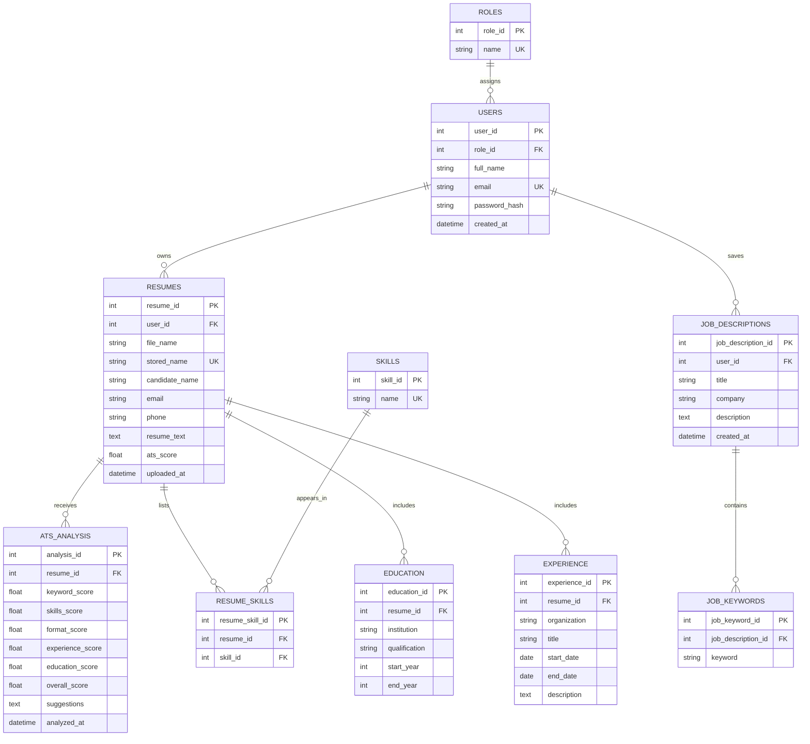

# Entity Relationship Diagram

All application tables below are created from the relational design implemented in `models.py`.

The resume-to-skill many-to-many relationship uses the associative table `resume_skills`. Every table has a primary key; foreign keys and uniqueness/check constraints are declared in `models.py`.
